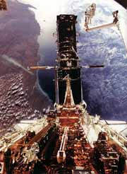
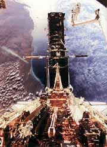
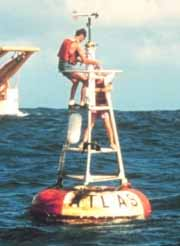
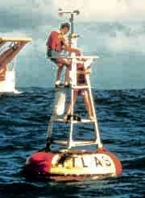

# Equalize Effect

Equalize modifies an image to ensure that all levels of brightness are equally well represented. This function is very similar to the AutoLevels effect but is designed to modify brightness rather than color levels.

## Settings

| Name | Default | Description |
| --- | --- | --- |
| None |  |  |

## Workings

Most images span an entire range of brightness with all levels well represented. However sometimes images are too light or too dark and some levels are overpopulated leaving others underpopulated.

The Equalize effect modifies an image so that all levels of brightness are equally well represented within the image.

## Example

The following example images show the effect of Equalize.

```csharp
void function() {
  using (Doc doc = new Doc()) {
    AddImagePage(doc, img2); // original image
    doc.Rendering.Save("EffectEqualize1.jpg");
    using (ImageLayer layer = AddImagePage(doc, img2)) {
      using (EffectOperation effect = new EffectOperation("Equalize")) {
        effect.Apply(layer.PixMap);
      }
    }
    doc.Rendering.Save("EffectEqualizeAfter1.jpg");
    AddImagePage(doc, img6); // original image
    doc.Rendering.Save("EffectEqualize2.jpg");
    using (ImageLayer layer = AddImagePage(doc, img6)) {
      using (EffectOperation effect = new EffectOperation("Equalize")) {
        effect.Apply(layer.PixMap);
      }
    }
    doc.Rendering.Save("EffectEqualizeAfter2.jpg");
  }
}
```

|  |  |
| --- | --- |
| <br>Original Image | <br>After Equalize |
| <br>Original Image | <br>After Equalize |
