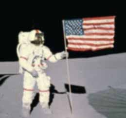

# Gaussian Blur Effect

A Gaussian Blur is a general purpose blur filter. This removes fine image detail and noise leaving only larger scale changes. Gaussian Blurs produce a very pure smoothing effect without side effects.

## Settings

| Name | Default | Description |
| --- | --- | --- |
| Radius | 1.5 pixels | Determines the scale of fine detail that will be removed. Low values remove only very fine detail while high values remove larger levels of detail.<br>This value represents the standard deviation of the Gaussian function. |

## Workings

A Gaussian Blur is distinct from other blurs in that it has a well defined effect on different levels of detail within an image. As the level of detail becomes smaller the filter lets through less and less. With other types of blur (e.g. Mean Filter) the amount let through may vary considerably.

As well as having this well defined and consistent frequency response, certain characteristics of the Gaussian function mean that large blurs can be applied much faster than other similar kinds of filters.

## Example

The following example images show the effect of Gaussian Blur.

```csharp
void function() {
  using (Doc doc = new Doc()) {
    AddImagePage(doc, img3); // original image
    doc.Rendering.Save("EffectGaussianBlur.jpg");
    using (ImageLayer layer = AddImagePage(doc, img3)) {
      using (EffectOperation effect = new EffectOperation("Gaussian Blur")) {
        effect.Parameters["Radius"].Value = 1.2;
        effect.Apply(layer.PixMap);
      }
    }
    doc.Rendering.Save("EffectGaussianBlur12.jpg");
    using (ImageLayer layer = AddImagePage(doc, img3)) {
      using (EffectOperation effect = new EffectOperation("Gaussian Blur")) {
        effect.Parameters["Radius"].Value = 2.5;
        effect.Apply(layer.PixMap);
      }
    }
    doc.Rendering.Save("EffectGaussianBlur25.jpg");
    using (ImageLayer layer = AddImagePage(doc, img3)) {
      using (EffectOperation effect = new EffectOperation("Gaussian Blur")) {
        effect.Parameters["Radius"].Value = 5.0;
        effect.Apply(layer.PixMap);
      }
    }
    doc.Rendering.Save("EffectGaussianBlur50.jpg");
  }
}
```

  
Original Image before Gaussian Blur

  
After Gaussian Blur Radius 1.2 pixels

  
After Gaussian Blur Radius 2.5 pixels

  
After Gaussian Blur Radius 5.0 pixels
