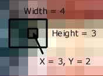

# Median Effect

The Median filter smoothes images using a fast median algorithm. The median algorithm is particularly good at removing "salt and pepper" noise from images without removing too much fine detail.

## Settings

| Name | Default | Description |
| --- | --- | --- |
| Width | 3 pixels | The width of the median filter to be applied. |
| Height | 3 pixels | The height of the median filter to be applied. |
| X | 2 pixels | The horizontal center of the filter in pixels from top left. |
| Y | 2 pixels | The vertical center of the filter in pixels from top left. |

## Workings

The median filter replaces each pixel with the median of its neighbors. The Median has a number of advantages over the Mean. Firstly unrepresentative pixels do not unduly influence the outcome of the final pixel level - this is why the filter is good at removing "salt and pepper" noise. Secondly, because the final pixel must actually be the value of one of its neighbors, edges are preserved more faithfully.

The image below show the neighboring pixels polled in a 4 by 3 Median Filter.



## Example

The following example images show the effect of a Median filter applied to a noisy picture at different width and height settings.

```csharp
void function() {
  using (Doc doc = new Doc()) {
    AddImagePage(doc, img5); // original image
    doc.Rendering.Save("EffectMedian.jpg");
    using (ImageLayer layer = AddImagePage(doc, img5)) {
      using (EffectOperation effect = new EffectOperation("Median")) {
        effect.Parameters["Width"].Value = 3;
        effect.Parameters["Height"].Value = 3;
        effect.Parameters["X"].Value = 2;
        effect.Parameters["Y"].Value = 2;
        effect.Apply(layer.PixMap);
      }
    }
    doc.Rendering.Save("EffectMedian3.jpg");
    using (ImageLayer layer = AddImagePage(doc, img5)) {
      using (EffectOperation effect = new EffectOperation("Median")) {
        effect.Parameters["Width"].Value = 5;
        effect.Parameters["Height"].Value = 5;
        effect.Parameters["X"].Value = 3;
        effect.Parameters["Y"].Value = 3;
        effect.Apply(layer.PixMap);
      }
    }
    doc.Rendering.Save("EffectMedian5.jpg");
    using (ImageLayer layer = AddImagePage(doc, img5)) {
      using (EffectOperation effect = new EffectOperation("Median")) {
        effect.Parameters["Width"].Value = 9;
        effect.Parameters["Height"].Value = 9;
        effect.Parameters["X"].Value = 4;
        effect.Parameters["Y"].Value = 4;
        effect.Apply(layer.PixMap);
      }
    }
    doc.Rendering.Save("EffectMedian9.jpg");
  }
}
```

  
Original Image before Median Filter

  
Width = 3, Height = 3, X = 2, Y = 2

  
Width = 5, Height = 5, X = 3, Y = 3

  
Width = 9, Height = 9, X = 4, Y = 4
