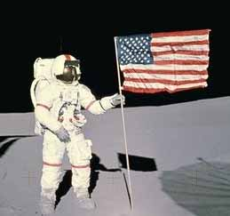
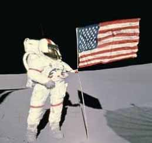
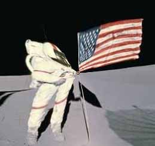
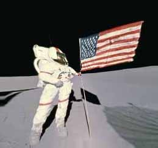

# Pinch Effect

The Pinch effect distorts the image as if it had been pinched.

## Settings

| Name | Default | Description |
| --- | --- | --- |
| Amount | 50 % | The amount that the image should be pinched. |
| Extent | 50 % | How far the effect should extend. |
| Speed | 3 | There is a general speed versus quality tradeoff. Higher values produce faster results at the expense of quality. |

## Workings

The effect distorts the image as if it had been pinched.

## Example

The following example images show the effect of a Pinch filter applied to a picture with different settings.

```csharp
void function() {
  using (Doc doc = new Doc()) {
    AddImagePage(doc, img3); // original image
    doc.Rendering.Save("EffectPinch.jpg");
    using (ImageLayer layer = AddImagePage(doc, img3)) {
      using (EffectOperation effect = new EffectOperation("Pinch")) {
        effect.Apply(layer.PixMap);
      }
    }
    doc.Rendering.Save("EffectPinchDefault.jpg");
    using (ImageLayer layer = AddImagePage(doc, img3)) {
      using (EffectOperation effect = new EffectOperation("Pinch")) {
        effect.Parameters["Amount"].Value = 75;
        effect.Apply(layer.PixMap);
      }
    }
    doc.Rendering.Save("EffectPinchAmount75.jpg");
    using (ImageLayer layer = AddImagePage(doc, img3)) {
      using (EffectOperation effect = new EffectOperation("Pinch")) {
        effect.Parameters["Extent"].Value = 100;
        effect.Apply(layer.PixMap);
      }
    }
    doc.Rendering.Save("EffectPinchExtent100.jpg");
  }
}
```

  
Original Image before Pinch

  
After Pinch with default settings

  
Amount = 75

  
Extent = 100
