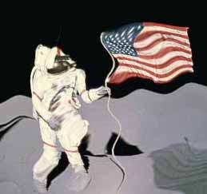
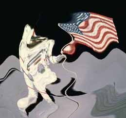
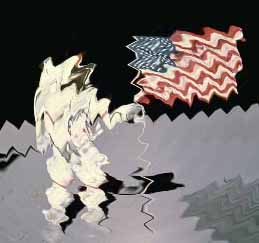

# Ripple Effect

The Pinch effect distorts the image as if it had been rippled.

## Settings

| Name | Default | Description |
| --- | --- | --- |
| Height | 10 pixels | The amplitude of the wave determines how high the ripples are on the surface of the images. |
| Length | 30 pixels | The length of the wave determines how far apart the ripples are placed. |
| Phase | 0 degrees | The phase determines if the center of the ripple is a peak or a trough. |
| Speed | 6 | There is a general speed versus quality tradeoff. Higher values produce faster results at the expense of quality. |

## Workings

The effect is very similar to a pond ripple. The image is distorted as if it was projected onto the surface of a pond and then a stone had been dropped into the middle.

## Example

The following example images show the effect of a Ripple filter applied to a picture with different settings.

```csharp
void function() {
  using (Doc doc = new Doc()) {
    AddImagePage(doc, img3); // original image
    doc.Rendering.Save("EffectRipple.jpg");
    using (ImageLayer layer = AddImagePage(doc, img3)) {
      using (EffectOperation effect = new EffectOperation("Ripple")) {
        effect.Apply(layer.PixMap);
      }
    }
    doc.Rendering.Save("EffectRippleDefault.jpg");
    using (ImageLayer layer = AddImagePage(doc, img3)) {
      using (EffectOperation effect = new EffectOperation("Ripple")) {
        effect.Parameters["Height"].Value = 15;
        effect.Apply(layer.PixMap);
      }
    }
    doc.Rendering.Save("EffectRippleHeight15.jpg");
    using (ImageLayer layer = AddImagePage(doc, img3)) {
      using (EffectOperation effect = new EffectOperation("Ripple")) {
        effect.Parameters["Length"].Value = 10;
        effect.Apply(layer.PixMap);
      }
    }
    doc.Rendering.Save("EffectRippleLength10.jpg");
  }
}
```

  
Original Image before Ripple

  
After Ripple with default settings

  
Height = 15

  
Length = 10
