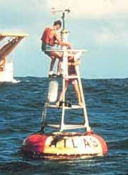
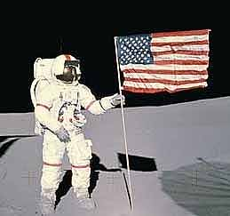
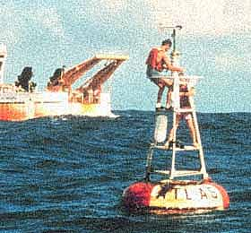

# Sharpen Effect

The Sharpen filter enhances edges using a simple algorithm. This is very fast to compute but can produce artificially over-sharp or over-noisy images if not used carefully.

## Settings

| Name | Default | Description |
| --- | --- | --- |
| None |  |  |

## Workings

The Sharpen Filter uses a simple three square convolution to enhance edges.

The matrix for this convolution is:

|  |  |  |
| :---: | --- | --- |
| -0.125 | -0.125 | -0.125 |
| -0.125 | **+2.000** | -0.125 |
| -0.125 | -0.125 | -0.125 |

## Example

The following examples show the effect of a Sharpen filter applied to a number of different images. Note that because JPEG compression has been used to compress these images some of the fine detail applied by the effect is not visible.

```csharp
void function() {
  using (Doc doc = new Doc()) {
    AddImagePage(doc, img5); // original image
    doc.Rendering.Save("EffectSharpen1a.jpg");
    using (ImageLayer layer = AddImagePage(doc, img5)) {
      using (EffectOperation effect = new EffectOperation("Sharpen")) {
        effect.Apply(layer.PixMap);
      }
    }
    doc.Rendering.Save("EffectSharpen1b.jpg");
    AddImagePage(doc, img3); // original image
    doc.Rendering.Save("EffectSharpen2a.jpg");
    using (ImageLayer layer = AddImagePage(doc, img3)) {
      using (EffectOperation effect = new EffectOperation("Sharpen")) {
        effect.Apply(layer.PixMap);
      }
    }
    doc.Rendering.Save("EffectSharpen2b.jpg");
    AddImagePage(doc, img6); // original image
    doc.Rendering.Save("EffectSharpen3a.jpg");
    using (ImageLayer layer = AddImagePage(doc, img6)) {
      using (EffectOperation effect = new EffectOperation("Sharpen")) {
        effect.Apply(layer.PixMap);
      }
    }
    doc.Rendering.Save("EffectSharpen3b.jpg");
  }
}
```

  
Original Image before Sharpen Filter

  
After Sharpen Filter Applied.

  
Original Image before Sharpen Filter

  
After Sharpen Filter Applied.

Note that as well as enhancing edges the effect has also enhanced 'mosquito noise' artifacts from the JPEG compression used on the original image. These are especially visible around the legs of the astronaut.

  
Original Image before Sharpen Filter

  
After Sharpen Filter Applied.

Note that the main effect here has been to enhance noise rather than improve quality.
