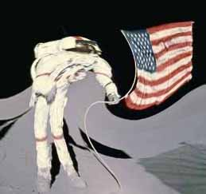
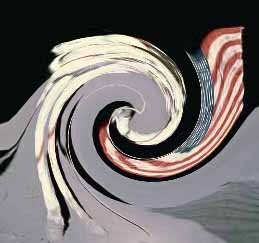
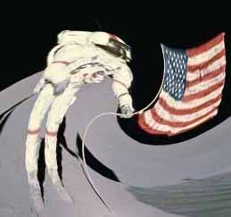

# Twirl Effect

The Twirl effect distorts the image as if it had been twirled.

## Settings

| Name | Default | Description |
| --- | --- | --- |
| Angle | 120 degrees | The amount that the image should be twirled. |
| Extent | 50 % | How far the effect should extend. |
| Speed | 8 | There is a general speed versus quality tradeoff. Higher values produce faster results at the expense of quality. |

## Workings

The effect distorts the image as if it had been twisted.

## Example

The following examples show the effect of a Twirl applied with a number of different settings.

```csharp
void function() {
  using (Doc doc = new Doc()) {
    AddImagePage(doc, img3); // original image
    doc.Rendering.Save("EffectTwirl.jpg");
    using (ImageLayer layer = AddImagePage(doc, img3)) {
      using (EffectOperation effect = new EffectOperation("Twirl")) {
        effect.Apply(layer.PixMap);
      }
    }
    doc.Rendering.Save("EffectTwirlDefault.jpg");
    using (ImageLayer layer = AddImagePage(doc, img3)) {
      using (EffectOperation effect = new EffectOperation("Twirl")) {
        effect.Parameters["Angle"].Value = 360;
        effect.Apply(layer.PixMap);
      }
    }
    doc.Rendering.Save("EffectTwirlAngle360.jpg");
    using (ImageLayer layer = AddImagePage(doc, img3)) {
      using (EffectOperation effect = new EffectOperation("Twirl")) {
        effect.Parameters["Extent"].Value = 100;
        effect.Apply(layer.PixMap);
      }
    }
    doc.Rendering.Save("EffectTwirlExtent100.jpg");
  }
}
```

  
Original Image before Twirl

  
After Twirl with default settings

  
Angle = 360

  
Extent = 100
